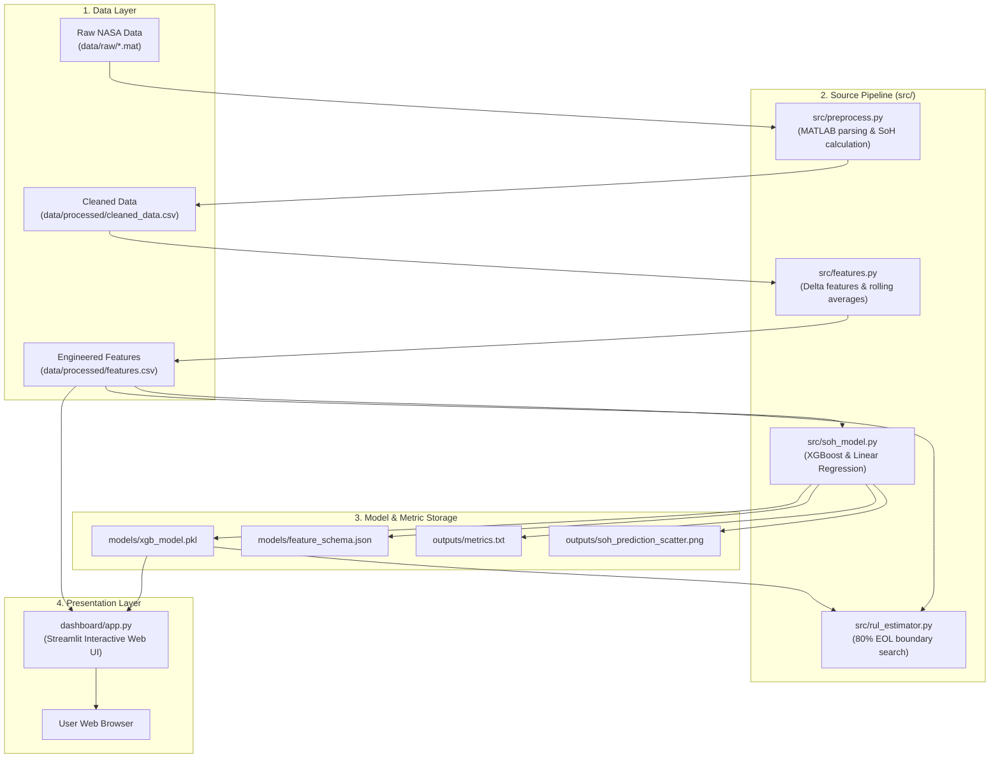
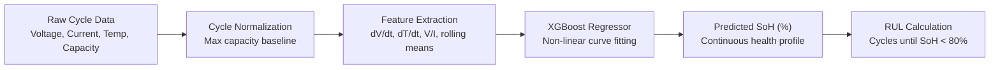

# System Architecture

This document provides a detailed breakdown of the module architecture, file organization, and data movement across the **EV Battery Health & RUL Estimation** project.

---

## 1. High-Level Architecture Diagram

---

## 2. Component Breakdown

| Directory / File | Type | Purpose | Primary Functions / Outputs |
| :--- | :--- | :--- | :--- |
| **`run_pipeline.py`** | Automation Runner | Master script executing Steps 1 through 4 sequentially with status reporting. | Runs preprocessing, feature engineering, model training, and RUL estimation. |
| **`src/preprocess.py`** | Pipeline Step 1 | Parses nested MATLAB `.mat` structs safely into tabular cycle telemetry. | Generates `data/processed/cleaned_data.csv`. |
| **`src/features.py`** | Pipeline Step 2 | Computes rates of change ($\frac{dV}{dt}$, $\frac{dT}{dt}$), resistance proxy ($V/I$), and 5-cycle rolling averages. | Generates `data/processed/features.csv`. |
| **`src/soh_model.py`** | Pipeline Step 3 | Implements battery-wise cross-validation, trains XGBoost, benchmarks against Linear Regression, and exports model artifacts. | Saves `models/xgb_model.pkl`, `feature_schema.json`, and `outputs/metrics.txt`. |
| **`src/rul_estimator.py`** | Pipeline Step 4 | Scans predicted degradation trajectories to identify the exact cycle where SoH drops below 80%. | Outputs console summary of remaining cycles per battery. |
| **`dashboard/app.py`** | Web Dashboard | Interactive Streamlit interface with 3 tabs: Health Status, SoH Trend, and Predictions & RUL. | Serves interactive UI at `http://localhost:8501`. |
| **`scripts/generate_figures.py`** | Asset Generator | Programmatically reproduces all publication-quality evaluation charts at 200 DPI. | Saves 6 figures to `docs/images/`. |
| **`scripts/capture_screenshots.py`** | UI Automation | Uses Playwright to capture authentic headless screenshots of the dashboard. | Saves 4 UI screenshots to `docs/images/`. |
| **`tests/test_pipeline.py`** | Quality Assurance | Smoke test validating model persistence, feature alignment, and prediction bounds. | Pass/fail test for CI/CD or local checks. |

---

## 3. Data Flow Diagram

---

## 4. Execution Environment Compatibility

The codebase avoids platform-specific hardcoded separators (`\` vs `/`) by wrapping all path logic in Python's standard `pathlib.Path`. It runs identically across:
* **Windows 10/11** (PowerShell or Command Prompt via `run_app.bat`)
* **macOS** (zsh / bash via `run_app.sh`)
* **Linux / Ubuntu** (bash via `run_app.sh`)
