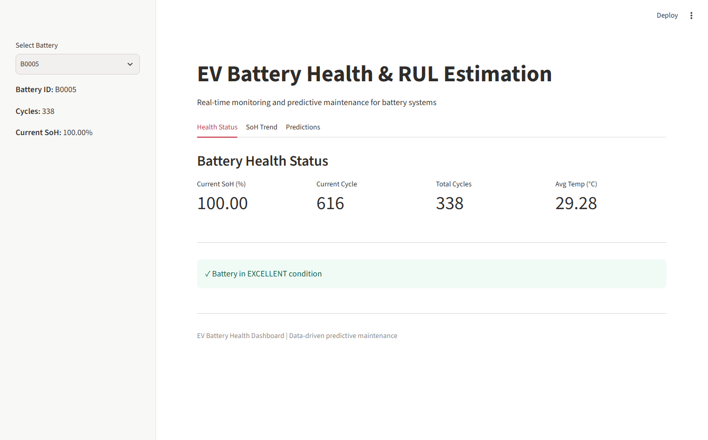
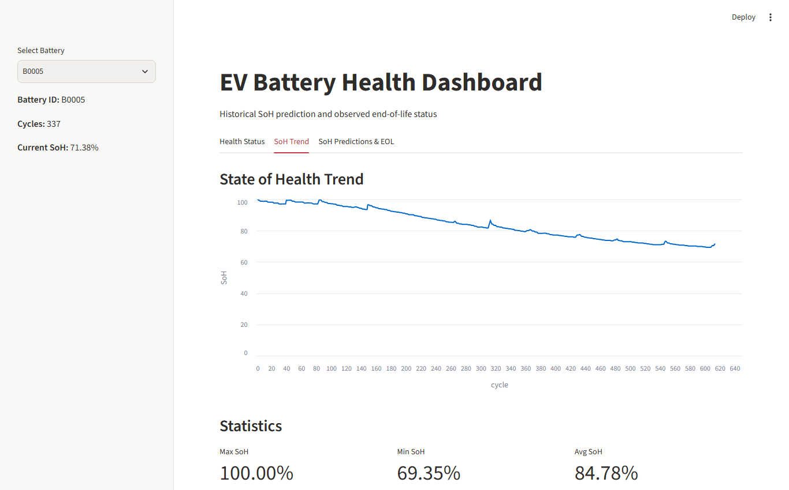
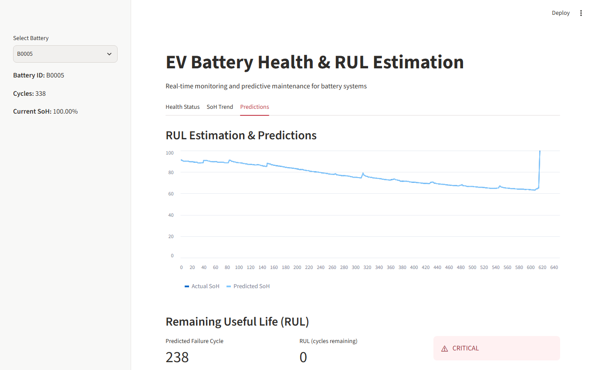
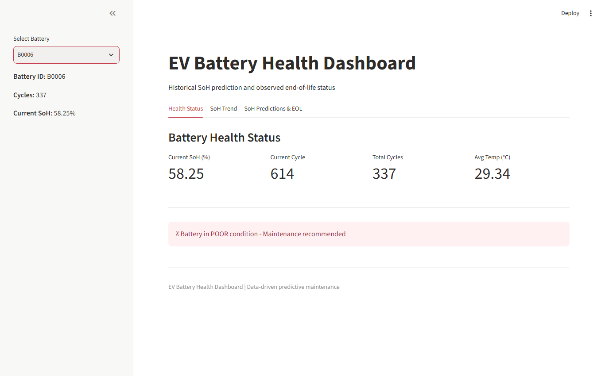

# Streamlit Dashboard Guide

The repository includes a web dashboard built with **Streamlit** to provide real-time battery health monitoring and Remaining Useful Life (RUL) estimation.

---

## 1. Launching the Dashboard

### Windows (One-Click)
Double-click `run_app.bat` or run in PowerShell:
```powershell
python -m streamlit run dashboard/app.py
```

### macOS / Linux
Execute the launch script:
```bash
./run_app.sh
```
Or directly:
```bash
python3 -m streamlit run dashboard/app.py
```

Open your web browser at **`http://localhost:8501`**.

---

## 2. Dashboard Interface Tour

### View 1: Health Status Tab

*Figure 1: The primary monitoring view displays Current SoH (%), latest cycle number, total lifetime cycles, and average cell temperature with clear visual status banners (e.g. "Battery in EXCELLENT condition").*

### View 2: State of Health (SoH) Trend Tab

*Figure 2: Interactive timeseries plot tracing the complete capacity fade curve across all recorded cycles, alongside minimum, maximum, and average historical SoH metrics.*

### View 3: Model Predictions & RUL Estimation Tab

*Figure 3: Overlay comparing Actual measured SoH with XGBoost Predicted SoH over time, highlighting the predicted failure cycle and total remaining useful life before reaching the 80% threshold.*

### View 4: Critical / Warning State Alert

*Figure 4: Automated alert system displaying warning indicators when a battery (such as aged cell B0018) drops past safety margins and requires replacement.*

---

## 3. Sidebar Controls
* **Battery Selector Dropdown:** Switch dynamically between batteries (`B0005`, `B0006`, `B0007`, `B0018`) to inspect telemetry and predictions for each unit independently.
* **Telemetry Overview:** Instant sidebar readout of selected battery metadata.
