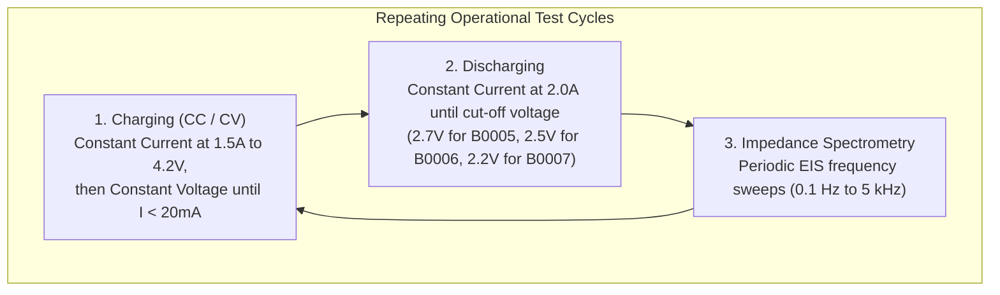

# NASA Li-ion Battery Aging Dataset

This document provides a guide to the dataset used in this project: experimental protocols, data structure, download steps, and citation.

---

## 1. Dataset Overview

The dataset comes from the **Prognostics Center of Excellence (PCoE)** at NASA Ames Research Center. It contains run-to-failure cycling data for commercial 18650-sized lithium-ion batteries.

Three primary cells are analyzed in this repository:
* **B0005**: 18650 Li-ion cell run at room temperature (24°C).
* **B0006**: 18650 Li-ion cell run at room temperature (24°C).
* **B0007**: 18650 Li-ion cell run at room temperature (24°C).
* *(Also included in processed telemetry: **B0018**, tested under accelerated thermal aging).*

Each cell underwent repeated test profiles until its capacity degraded past 30% fade (well below the commonly used 80% SoH end-of-life threshold).

---

## 2. Experimental Cycling Protocols



1. **Charging Cycle:**
   * **Constant Current (CC):** Charged at 1.5 A until cell voltage reached 4.2 V.
   * **Constant Voltage (CV):** Held steady at 4.2 V until charging current dropped below 20 mA.
2. **Discharging Cycle:**
   * Discharged under constant current (2.0 A) until cell cut-off thresholds were triggered (2.7 V, 2.5 V, and 2.2 V respectively).
3. **Electrochemical Impedance Spectroscopy (EIS):**
   * Swept across frequency bands to measure internal electrolyte resistance ($R_e$) and charge transfer resistance ($R_{ct}$).

---

## 3. MATLAB `.mat` File Internal Structure

The raw NASA archive files (`B0005.mat`, `B0006.mat`, etc.) store high-frequency timeseries inside nested MATLAB objects:

```text
B0005
└── cycle (array of structs, 1 to 616)
    ├── type: 'charge' | 'discharge' | 'impedance'
    ├── ambient_temperature: float (e.g. 24)
    ├── time: [year, month, day, hour, minute, second]
    └── data
        ├── Voltage_measured: [1 x N array of float]
        ├── Current_measured: [1 x N array of float]
        ├── Temperature_measured: [1 x N array of float]
        ├── Current_load: [1 x N array of float]
        ├── Voltage_load: [1 x N array of float]
        ├── Time: [1 x N array of float]
        └── Capacity: scalar float (Ampere-hours, discharge cycles)
```

### Parsing Pipeline (`src/preprocess.py`)
Because nested MATLAB structs can be awkward to read directly in Python, `src/preprocess.py` extracts records with valid positive discharge capacity, computes SoH relative to each cell's first measured capacity, and saves the clean tabular data to `data/processed/cleaned_data.csv`. Feature engineering writes the resulting table to `data/processed/features.csv`.

---

## 4. Download and Setup Instructions

The raw MATLAB files are approximately 150 MB and are not checked into git. If you want to re-run the raw preprocessing from scratch:

1. **Visit the official NASA repository:**
   * URL: [NASA Prognostics Data Repository](https://www.nasa.gov/intelligent-systems-division/discovery-and-systems-health/pcoe/pcoe-data-set-repository/)
   * Dataset: **"5. Battery Data Set"** (`BatteryAgingARC-FY08Q4`)
2. **Download the archive:**
   * Download `5. Battery Data Set.zip`.
3. **Extract and Place Files:**
   * Extract `B0005.mat`, `B0006.mat`, and `B0007.mat` directly into:
     ```text
     data/raw/B0005.mat
     data/raw/B0006.mat
     data/raw/B0007.mat
     ```
4. **Run the Preprocessing:**
   ```bash
   python run_pipeline.py
   ```

*(Note: Pre-extracted features are already supplied at `data/processed/features.csv`, so you can immediately train models and run the dashboard without re-downloading the raw files. The included labels use each cell's first valid capacity as its baseline, and known synthetic cycle-616 terminal spikes are excluded.)*

---

## 5. Dataset Citation

If you reference this dataset or work, please cite the original NASA publication:

```bibtex
@misc{saha2007battery,
  author = {B. Saha and K. Goebel},
  title = {Battery Data Set},
  howpublished = {NASA Ames Prognostics Data Repository},
  institution = {NASA Ames Research Center, Moffett Field, CA},
  year = {2007},
  url = {https://www.nasa.gov/intelligent-systems-division/discovery-and-systems-health/pcoe/pcoe-data-set-repository/}
}
```
