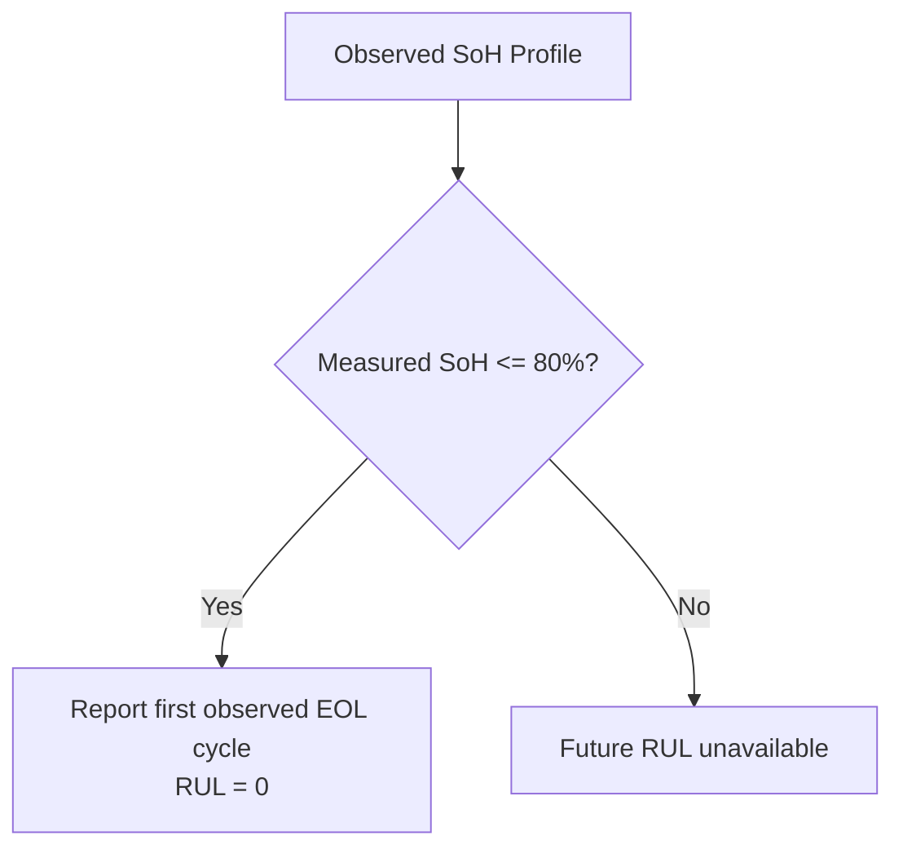

# Machine Learning Methodology

This document outlines the machine learning pipeline, feature engineering rationale, evaluation strategies, and design decisions used in this repository.

---

## 1. Problem Formulation

An EV battery degrades over time due to solid electrolyte interphase (SEI) growth, lithium plating, and active material loss. In automotive applications, two core metrics are tracked:
* **State of Health (SoH, %):** The percentage of charge storage capacity remaining compared to when the battery was brand new ($SoH = \frac{C_{\text{current}}}{C_{\text{initial}}} \times 100\%$).
* **Remaining Useful Life (RUL, cycles):** The number of charge-discharge cycles remaining before the cell's SoH drops below **80.0%**.

---

## 2. Feature Engineering Rationale

Raw voltage, current, and temperature time series are aggregated per cycle into high-signal physical indicators:

| Feature Name | Formula / Definition | Physical Motivation |
| :--- | :--- | :--- |
| `voltage_mean` | $\bar{V} = \frac{1}{N}\sum V_i$ | Terminal cell voltage drops faster as the battery ages. |
| `current_mean` | $\bar{I} = \frac{1}{N}\sum I_i$ | Average current indicates load profile consistency. |
| `temp_mean` | $\bar{T} = \frac{1}{N}\sum T_i$ | Higher internal resistance increases resistive heating ($I^2 R$). |
| `capacity_fade_rate` | $C_{k-1} - C_k$ | First derivative of capacity loss per cycle. Captures acceleration in degradation. |
| `rolling_SoH_mean` | $\frac{1}{5}\sum_{j=k-4}^k SoH_j$ | 5-cycle moving average to smooth transient noise and capacity regeneration bumps. |
| `rolling_temp_mean`| $\frac{1}{5}\sum_{j=k-4}^k \bar{T}_j$ | Thermal moving average to track baseline operating temperature. |
| `dV_dt` | $\bar{V}_k - \bar{V}_{k-1}$ | Cycle-to-cycle change in mean voltage. |
| `dT_dt` | $\bar{T}_k - \bar{T}_{k-1}$ | Cycle-to-cycle change in operating temperature. |
| `internal_resistance_proxy` | $\bar{V}_k / \bar{I}_k$ | Ohm's law approximation for internal cell impedance. |

---

## 3. Why XGBoost Over Deep Learning (LSTM / Transformers)

A common question is why gradient-boosted decision trees (XGBoost) were selected instead of recurrent neural networks (LSTMs):

1. **Dataset Size:** The dataset has ~1,280 total operational cycles across 4 cells. Deep neural networks like LSTMs easily overfit on small tabular datasets without heavy regularization.
2. **Tabular Efficiency:** Decision tree ensembles consistently match or outperform deep architectures on tabular feature sets while training in seconds rather than hours.
3. **Interpretability:** XGBoost natively provides feature importance rankings (see `docs/images/4_xgboost_feature_importance.png`), making the model explainable to automotive battery management system (BMS) engineers.
4. **Edge Deployment:** Tree models have negligible memory footprints and execute inference in sub-millisecond speeds, making them practical for low-power automotive ECUs.

---

## 4. Train / Test Split Strategy & Data Leakage Avoidance

### The Danger of Random Splitting
In battery prognostics, randomly splitting cycles (e.g. 80% train, 20% test via `train_test_split`) causes **data leakage**. Consecutive cycles (e.g. cycle 41 and cycle 42 of cell B0005) share near-identical states. A model evaluated this way can memorize cell trajectories, yielding an artificially optimistic error (`MAE = 0.8492% SoH`).

### The Solution: Battery-wise Validation
To accurately simulate a real-world BMS deploying onto an unseen vehicle battery:
* **Training Set:** Batteries **B0005**, **B0006**, and **B0018** (942 total cycles).
* **Testing Set:** Battery **B0007** (338 cycles) — completely unseen during training.

This guarantees that the model learns general electrochemical aging dynamics rather than memorizing a specific cell's profile.

---

## 5. End-of-Life and RUL Reporting

The 80% threshold is a commonly used battery end-of-life convention, not a universal safety guarantee. This release reports the first observed cycle at or below the threshold and zero RUL once a supplied profile has crossed it. A model applied only to historical rows cannot estimate a future crossing for a still-healthy battery; forecasting that crossing requires a validated future-feature or degradation-trend model and is outside this release.

The trained SoH model uses sensor-only inputs (`voltage_mean`, `current_mean`, `temp_mean`, `dV_dt`, `dT_dt`, and `internal_resistance_proxy`). Capacity and capacity-derived features are excluded to avoid predicting a label directly from its measurement.
